# Bài 1 – Tổng quan hệ thống và MEP

**Học phần:** Phát triển ứng dụng phân tán (PTUDPT)  
**Họ và tên:** Đặng Quốc Trung  
**MSSV:** DTC245200016  
**Lớp:** *[Bổ sung tên lớp theo danh sách của giảng viên]*  
**Ngày thực hành:** 04/11/2026  
**Dự án tự thực hiện:** `EduSubmit-DTC245200016`  
**Môi trường:** Windows, Visual Studio Code, .NET 10, Git, REST Client.

> **Phạm vi nhật ký:** Ghi nhận kết quả thực hành theo 7 mục ở Phụ lục 3 tài liệu hướng dẫn. Ảnh cài đặt ở Bước 4 không được chèn theo lựa chọn của người thực hiện. Các hình bên dưới là ảnh chụp thực tế trong quá trình thao tác; những kết quả chưa được xác nhận (như GitHub đã push/tag) không được trình bày như đã hoàn tất.

## 1. Cài đặt

Máy đã cài đặt và sử dụng được các công cụ phục vụ bài thực hành:

| Thành phần | Kết quả kiểm tra |
|---|---|
| .NET SDK | `dotnet --version` → `10.0.102` |
| Git | `git --version` → `2.53.0.windows.2` |
| VS Code | Mở và biên dịch được các project C# trên Windows |
| REST Client | Gửi các HTTP request từ file `.http` và nhận phản hồi |
| Console App | Chạy thành công `Hello, World!` trong project `HelloPtudpt` |

Đã kiểm tra khả năng tạo project, khôi phục package, biên dịch và chạy chương trình bằng `dotnet new`, `dotnet build`, `dotnet run`. **Không đính kèm ảnh cài đặt Bước 4** theo yêu cầu của người thực hiện.

## 2. MepDemo (Bước 7)

Đã mở và chạy dự án `MepDemo` do giảng viên cung cấp; quan sát các mô hình trao đổi thông điệp (MEP) thông qua chương trình mô phỏng. Các lệnh sử dụng gồm `dotnet run` (chạy cả 5 MEP), `dotnet run -- 3` và `dotnet run -- 4`.

### 2.1. Trả lời câu hỏi

**Câu 1. Ở MEP 3, mỗi bài nộp `sub-x` được mấy worker xử lý?**  
Mỗi bài nộp chỉ do **một worker** xử lý. Các worker cạnh tranh lấy công việc từ một hàng đợi chung, giúp phân chia tải và tránh xử lý trùng một công việc trong ví dụ này.

**Câu 2. Ở MEP 4, một sự kiện được gửi tới mấy dịch vụ?**  
Một sự kiện `SubmissionGraded` được chuyển tới **ba dịch vụ đã đăng ký**: `ScoreService`, `NotificationService` và `StatsService`.

**Câu 3. Mô tả mỗi MEP bằng một câu:**

| MEP | Mô tả |
|---|---|
| 1. Request–Response | Bên gửi gửi yêu cầu và chờ phản hồi hoặc xử lý lỗi quá thời gian chờ. |
| 2. One-way | Bên gửi chuyển thông điệp rồi tiếp tục công việc, không chờ phản hồi nghiệp vụ. |
| 3. Queue-based | Công việc được đưa vào hàng đợi để các worker lấy ra và chia nhau xử lý. |
| 4. Publish–Subscribe | Một sự kiện được phát tới nhiều bên đăng ký độc lập để mỗi bên thực hiện tác vụ riêng. |
| 5. Streaming / Push | Bên nhận tiếp tục nhận các bản cập nhật trên một luồng mà không cần gửi yêu cầu mới cho từng cập nhật. |

### 2.2. Ảnh minh chứng

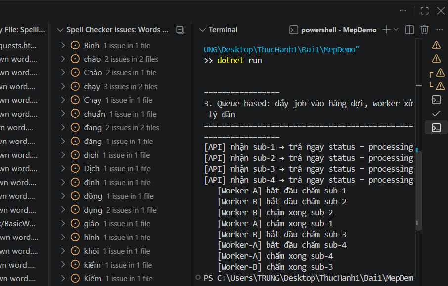

*Hình 1. MEP 3 – Queue-based: bốn công việc `sub-1` đến `sub-4` được chia cho Worker-A và Worker-B; mỗi bài được một worker xử lý.*

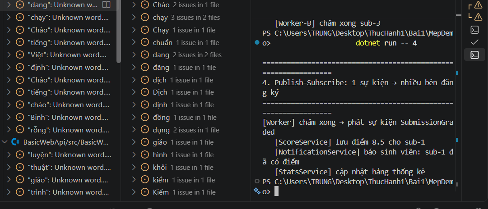

*Hình 2. MEP 4 – Publish–Subscribe: sự kiện `SubmissionGraded` được xử lý bởi ScoreService, NotificationService và StatsService.*

## 3. BasicWebApi (Bước 8)

### 3.1. Chạy và kiểm thử REST Client

Đã biên dịch và chạy `BasicWebApi`, sử dụng REST Client để kiểm thử phương thức GET và POST. Khi có xung đột cổng, API được chạy tại `http://localhost:5082` và file `requests.http` được cập nhật tương ứng.

| Thao tác kiểm thử | Phản hồi thực tế | Nhận xét |
|---|---|---|
| GET `/` | `200 OK`, JSON có `application: "BasicWebApi"` | API đang hoạt động |
| GET `/hello/An?language=vi` | `200 OK`, `Xin chào, An!` | Xử lý tiếng Việt |
| GET `/hello/An?language=en` | `200 OK`, `Hello, An!` | Xử lý tiếng Anh |
| POST `/greetings` với `name = "Binh"` | `201 Created`, có `Location` | Tạo lời chào hợp lệ |
| POST `/greetings` với `name = ""` | `400 Bad Request`, `Name must not be empty.` | Từ chối dữ liệu sai |

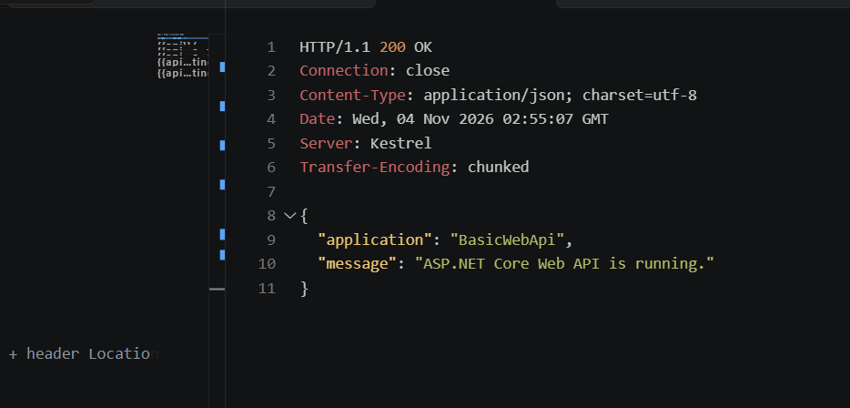

*Hình 3. REST Client nhận HTTP 200 OK từ endpoint GET `/` của BasicWebApi.*

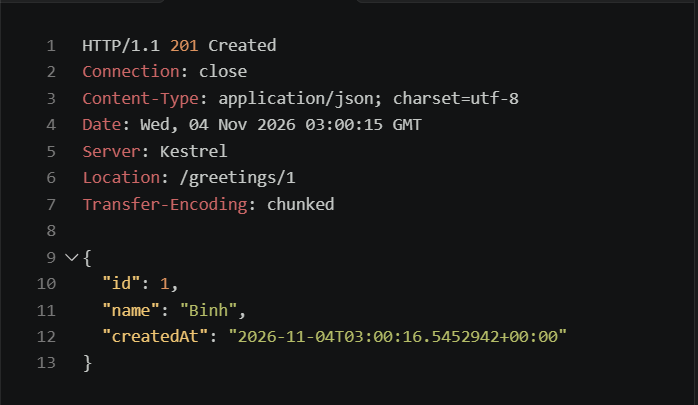

*Hình 4. POST `/greetings` với tên hợp lệ trả HTTP 201 Created, có header `Location`, ID và thời gian tạo.*

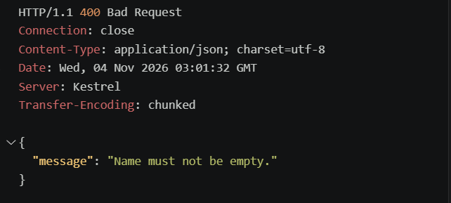

*Hình 5. POST `/greetings` với `name` rỗng trả HTTP 400 Bad Request và thông báo kiểm tra đầu vào.*

### 3.2. Trả lời ba câu hỏi Bước 8.4

**Câu 1. Vì sao `builder.Services.AddSingleton<GreetingService>()` phải đứng trước `builder.Build()`?**  
Dịch vụ cần được đăng ký vào bộ chứa dependency injection khi cấu hình `builder`, trước khi xây dựng ứng dụng. Sau `builder.Build()`, việc đăng ký dịch vụ theo cách đó không còn hợp lệ.

**Câu 2. Trong `/hello/{name}?language=en`, `name` và `language` đến từ đâu?**  
`name` được ánh xạ từ đoạn đường dẫn (*route parameter*), ví dụ `An`; `language` được lấy từ chuỗi truy vấn (*query string*), ví dụ `en`.

**Câu 3. Vì sao POST hợp lệ dùng `Results.Created` (201) thay vì `Results.Ok` (200)?**  
Vì POST ghi nhận một tài nguyên mới. Mã `201 Created` và header `Location` mô tả đúng việc tạo tài nguyên và vị trí truy cập dự kiến của tài nguyên đó.

### 3.3. Tự sửa code: thêm tiếng Nhật (Bước 8.5)

Đã bổ sung nhánh `language=ja` để API trả lời `Konnichiwa, {name}!`. Khi thử `GET /hello/An?language=ja`, chương trình trả về `{"message":"Konnichiwa, An!"}`.

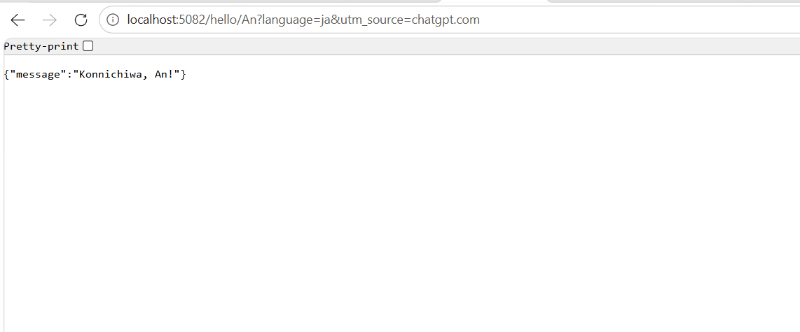

*Hình 6. Kiểm thử endpoint `language=ja`; BasicWebApi trả đúng thông điệp `Konnichiwa, An!`.*

### 3.4. Debug request POST (Bước 8.6)

Đặt breakpoint tại lệnh `var greeting = service.Create(request.Name.Trim());`. Gửi HTTP POST mang JSON `{"name":"Binh"}` và quan sát chương trình tạm dừng ở breakpoint. Ảnh breakpoint ghi nhận dòng đang thực thi; ảnh request ghi nhận tên được gửi đi (ảnh breakpoint chưa hiển thị tooltip giá trị biến).

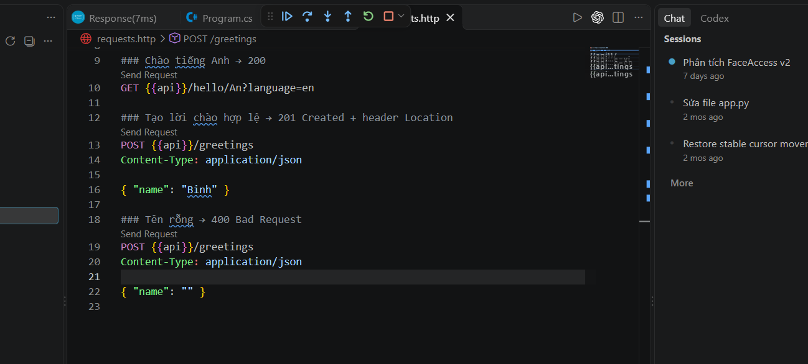

*Hình 7. File `requests.http`: POST `/greetings` gửi JSON có trường `name` là `Binh`.*

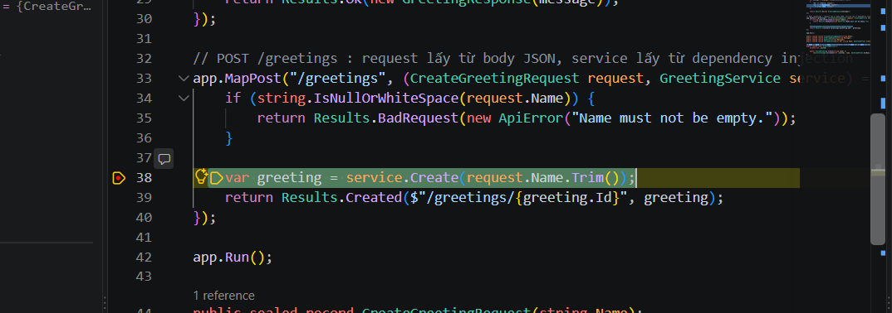

*Hình 8. Debug BasicWebApi: chương trình tạm dừng ở dòng tạo lời chào khi xử lý POST `/greetings`.*

## 4. MiniDistributedSystem (Bước 9)

Đã chạy hai tiến trình độc lập `Submission.Api` (máy chủ) và `Submission.Client` (máy khách) trên Windows. API lắng nghe tại `http://localhost:5000`; Client lấy danh sách hai bài tập bằng GET và gửi lượt nộp bằng POST. Kết quả Client có mã GUID và trạng thái `received`; API trả `201 Created` cho yêu cầu POST hợp lệ.

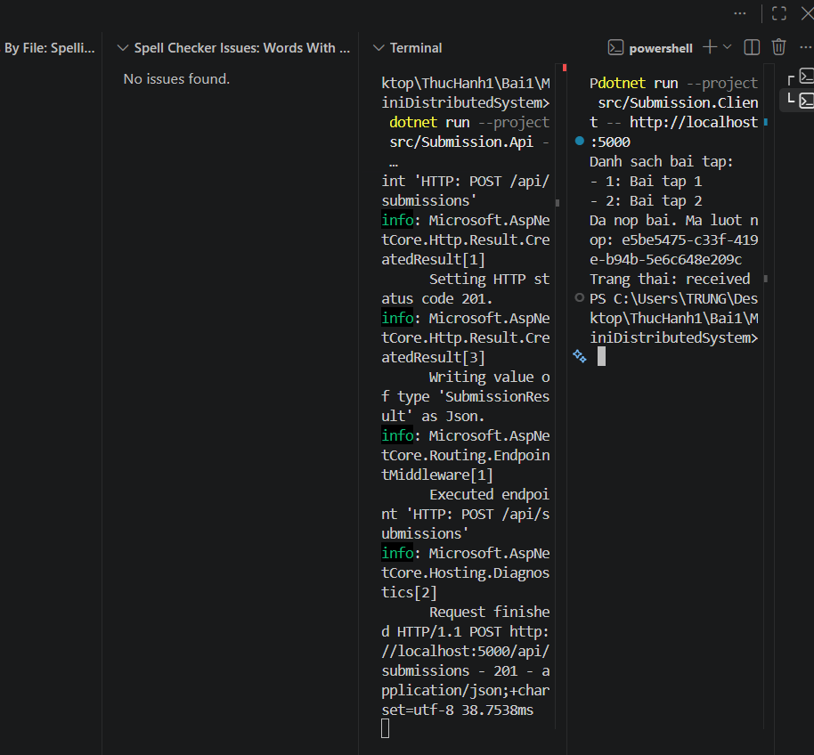

*Hình 9. Chạy MiniDistributedSystem: API xử lý HTTP và Client hiển thị hai bài tập, GUID cùng trạng thái `received`.*

### Trả lời ba câu hỏi Bước 9

**Câu 1. Client gọi endpoint nào, theo phương thức và trạng thái nào?**

| Phương thức | Endpoint | Mục đích | Mã trạng thái thành công |
|---|---|---|---|
| GET | `/api/assignments` | Lấy danh sách bài tập | `200 OK` |
| POST | `/api/submissions` | Nộp bài và nhận mã lượt nộp | `201 Created` |

**Câu 2. Client có dùng chung code API không? Hai bên thống nhất qua gì?**  
Không. Hai project hoạt động như hai tiến trình độc lập, không tham chiếu trực tiếp mã nguồn của nhau. Chúng thống nhất qua giao diện HTTP: endpoint, method, cấu trúc JSON/DTO và mã trạng thái phản hồi.

**Câu 3. Vì sao API URL được truyền qua tham số dòng lệnh?**  
Để sử dụng cùng một bản Client ở các máy chủ hoặc cổng khác nhau mà không phải sửa và biên dịch lại code; ví dụ chuyển từ `http://localhost:5000` sang `http://localhost:5050`.

## 5. Thí nghiệm lỗi (Bước 10)

Các thí nghiệm được thực hiện trên dự án mẫu `MiniDistributedSystem`; dự đoán được đưa ra trước khi chạy, rồi đối chiếu với kết quả thực tế.

| # | Dự đoán (trước khi chạy) | Kết quả thực tế | Đúng/Sai | Giải thích |
|---|---|---|---|---|
| a | Thêm bài tập thứ ba vào API thì Client tự hiển thị ba bài, không cần sửa Client. | Client in `Bai tap 1`, `Bai tap 2`, `Bai tap 3` và nộp bài thành công. | **Đúng** | Client lấy dữ liệu động bằng GET `/api/assignments`; số lượng bài tập không được ghi cứng trong Client. |
| b | Tắt API thì Client không kết nối được đến cổng 5000. | `HttpRequestException`, kèm `No connection could be made because the target machine actively refused it`. | **Đúng** | Lời gọi qua mạng phụ thuộc tiến trình server và kết nối; lời gọi hàm trong cùng tiến trình không gặp lỗi *mất kết nối mạng*, dù vẫn có thể gặp các lỗi khác. |
| c | `StudentCode` rỗng sẽ bị API từ chối với HTTP 400; `EnsureSuccessStatusCode()` gây ngoại lệ. | API trả `400 Bad Request`; Client báo `HttpRequestException: Response status code does not indicate success: 400`. | **Đúng** | Máy chủ phải tự kiểm tra dữ liệu vì không thể tin tưởng hoàn toàn dữ liệu từ phía Client; `EnsureSuccessStatusCode()` ném ngoại lệ khi phản hồi không có mã 2xx. |
| d | API chạy 5050 nhưng Client gọi 5000 sẽ bị từ chối; đổi tham số Client sang 5050 sẽ hoạt động. | Sai cổng xuất hiện lỗi kết nối; đổi URL thành `http://localhost:5050` thì Client lấy danh sách và nộp bài thành công. | **Đúng** | Địa chỉ và cổng là một phần của đích kết nối; truyền qua tham số giúp khắc phục không cần sửa code. |

### 5.1. Ảnh minh chứng thí nghiệm

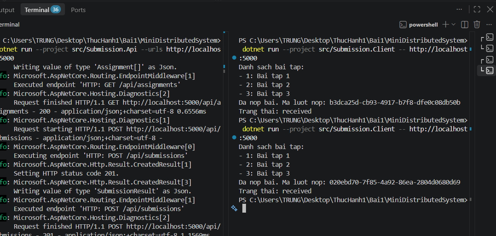

*Hình 10. Thí nghiệm 10a: khi API mẫu có ba bài tập, Client tự hiển thị ba mục và tiếp tục nộp bài thành công.*

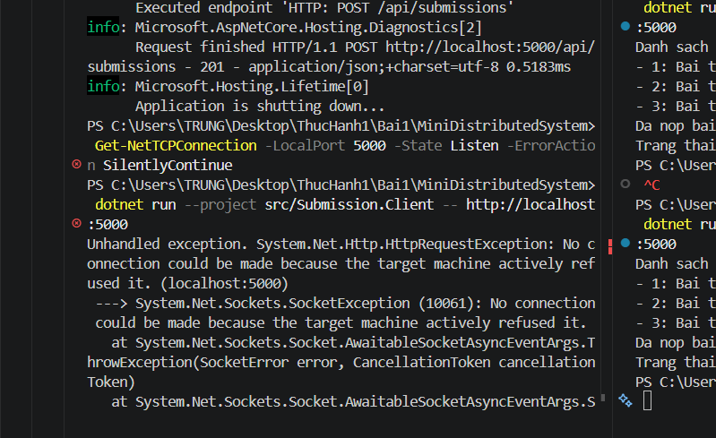

*Hình 11. Thí nghiệm 10b: API đã dừng; Client kết nối đến cổng 5000 và bị từ chối (`HttpRequestException`).*

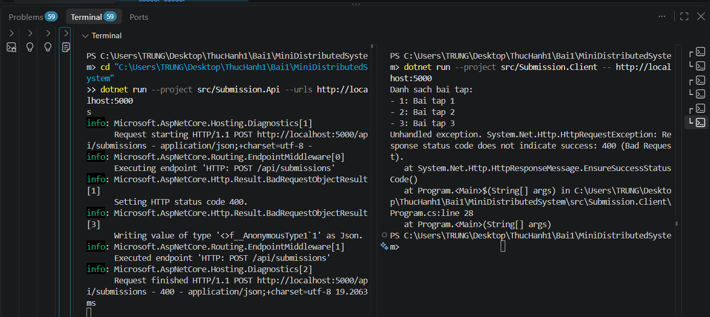

*Hình 12. Thí nghiệm 10c: API ghi nhận phản hồi HTTP 400; Client báo ngoại lệ tại `EnsureSuccessStatusCode()`.*

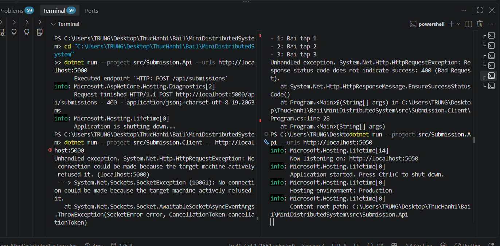

*Hình 13. Thí nghiệm 10d: API lắng nghe ở 5050 nhưng Client gọi 5000 nên phát sinh lỗi kết nối.*

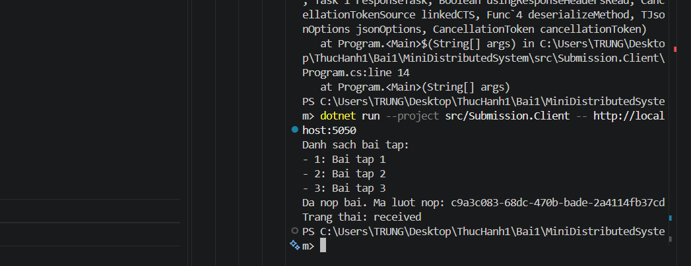

*Hình 14. Thí nghiệm 10d: đổi tham số dòng lệnh để Client gọi cổng 5050; kết nối được khôi phục và lượt nộp được tiếp nhận.*

**Ghi chú:** Ở ảnh thí nghiệm 10d, API mẫu vẫn hiện ba bài tập do chỉnh sửa trong thí nghiệm 10a. Điều này không ảnh hưởng đến kết luận về lỗi sai cổng; cần kiểm tra và khôi phục dữ liệu mẫu về hai bài nếu tiếp tục dùng code mẫu.

## 6. Dự án EduSubmit tự làm (Bước 11–12)

### 6.1. Tạo hệ thống gồm API và Client

Đã tạo solution `EduSubmit.slnx`, hai project `src/Submission.Api` và `src/Submission.Client` trên .NET 10. Hai project biên dịch thành công, được chạy ở hai Terminal độc lập và giao tiếp bằng HTTP, không tham chiếu trực tiếp code của nhau.

- API cung cấp `GET /`, `GET /api/assignments` và `POST /api/submissions`.
- Client dùng `HttpClient`, gọi GET để lấy danh sách, POST để nộp bài và đọc GUID/trạng thái trả về.
- Khi POST hợp lệ, API trả `201 Created` kèm `Location`, `id`, `status = "received"` và `receivedAt`.
- Khi dữ liệu sai/thiếu, API trả `400 Bad Request`.

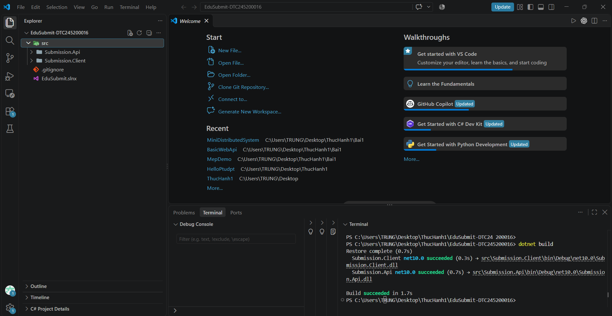

*Hình 15. Solution EduSubmit có hai project Submission.Api và Submission.Client; cả hai build thành công trên .NET 10.*

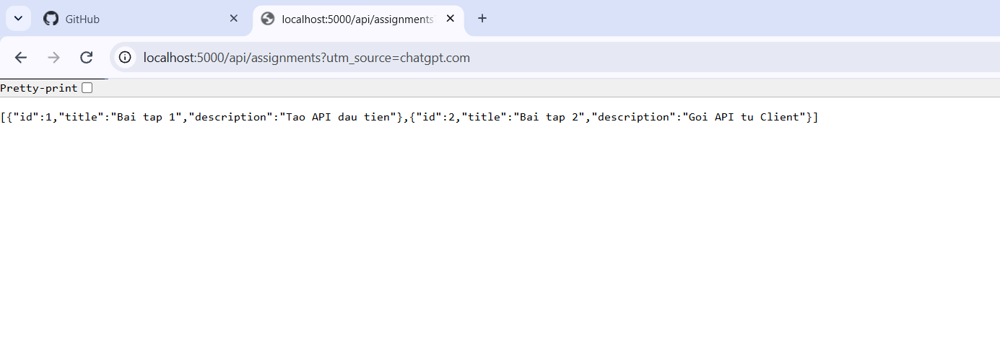

*Hình 16. EduSubmit: GET `/api/assignments` trả hai bài tập ở định dạng JSON.*

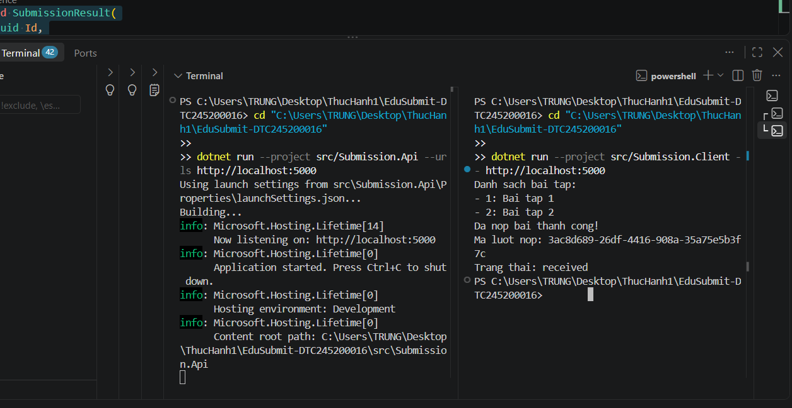

*Hình 17. Hai tiến trình EduSubmit: Client nhận danh sách hai bài tập và nộp bài thành công, nhận GUID và trạng thái `received`.*

### 6.2. Kiểm thử HTTP

| Yêu cầu | Kết quả được ghi nhận |
|---|---|
| GET `/` | `200 OK`, `service: "Submission.Api"`, `status: "running"` |
| GET `/api/assignments` | `200 OK`, danh sách hai bài tập |
| POST `/api/submissions` hợp lệ | `201 Created`, GUID, `Location`, `receivedAt` |
| POST `/api/submissions` sai dữ liệu | `400 Bad Request`, `Du lieu nop bai khong hop le` |

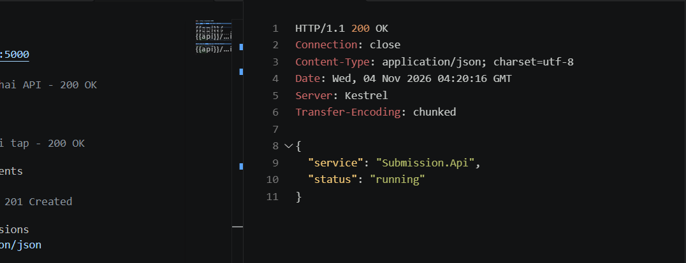

*Hình 18. REST Client kiểm thử GET `/` của EduSubmit: HTTP 200 OK.*

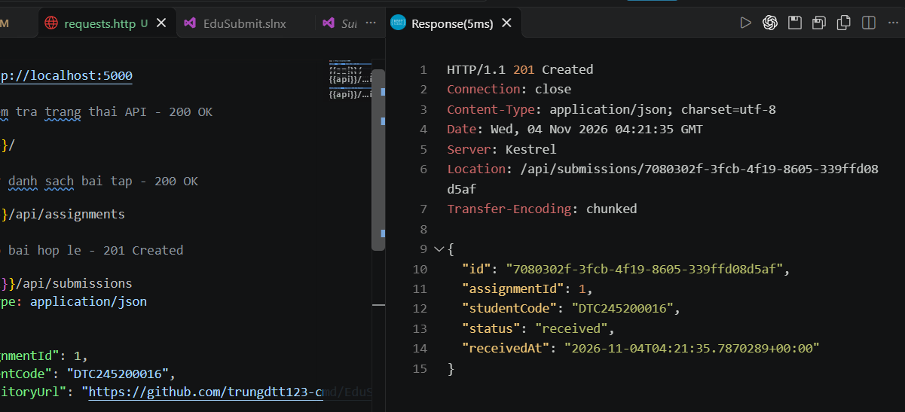

*Hình 19. REST Client kiểm thử POST hợp lệ: HTTP 201 Created, mã GUID và trạng thái `received`.*

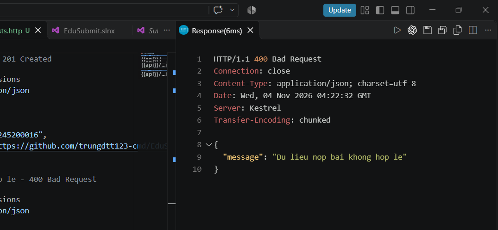

*Hình 20. REST Client kiểm thử POST dữ liệu không hợp lệ: HTTP 400 Bad Request.*

### 6.3. Bài mở rộng Bước 12 – Tra cứu lượt nộp theo GUID

API được bổ sung bộ lưu lượt nộp trong RAM bằng `ConcurrentDictionary<Guid, SubmissionResult>` và endpoint `GET /api/submissions/{id:guid}`:

- Nếu GUID tồn tại: trả **200 OK** và dữ liệu lượt nộp tương ứng.
- Nếu GUID không tồn tại: trả **404 Not Found**.
- Sau khi POST thành công, Client gọi GET theo GUID vừa nhận, rồi in `ID`, MSSV, trạng thái và thời gian tiếp nhận.

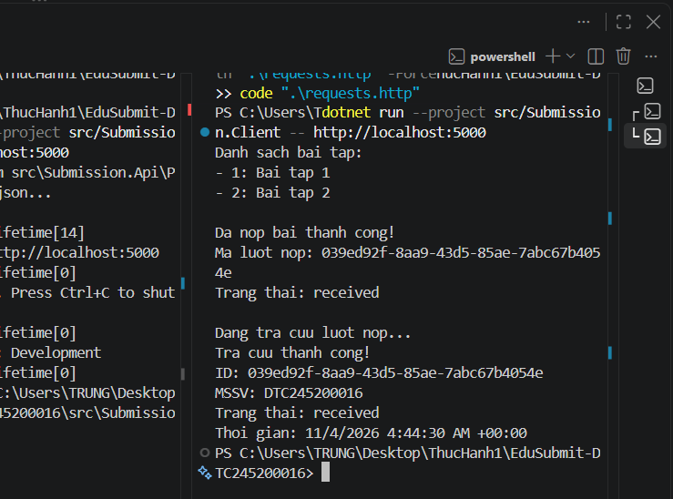

*Hình 21. Client nộp bài thành công và truy vấn lại lượt nộp bằng cùng GUID; trạng thái trả về là `received`.*

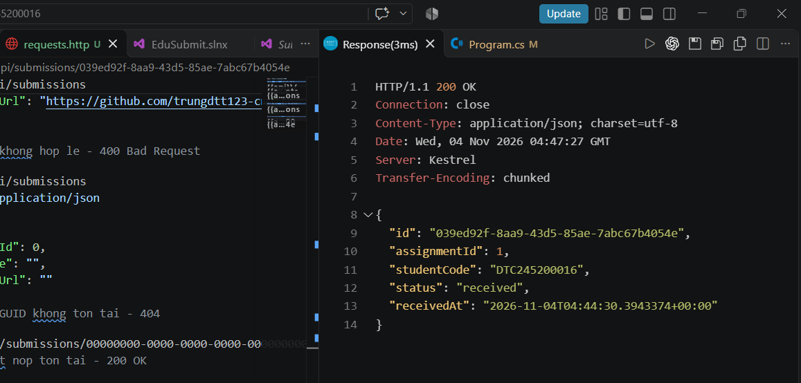

*Hình 22. Tra cứu GUID đã có trong bộ nhớ: API trả HTTP 200 OK và thông tin lượt nộp.*

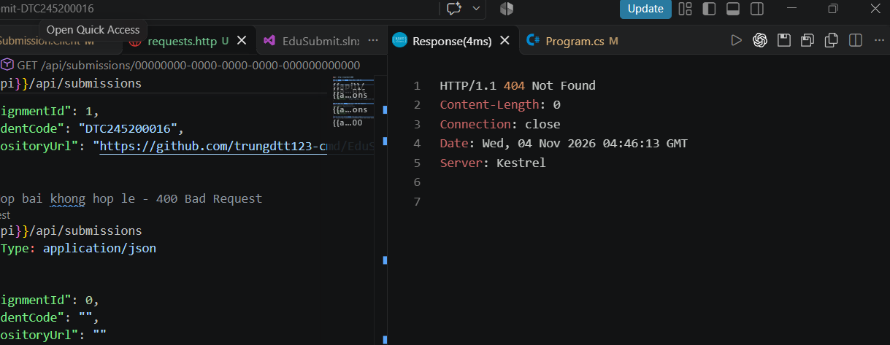

*Hình 23. Tra cứu GUID toàn số 0 không tồn tại: API trả HTTP 404 Not Found.*

**Giới hạn:** Dữ liệu được giữ trong RAM để phục vụ thực hành, không được lưu vào cơ sở dữ liệu. Khi khởi động lại tiến trình API, các lượt nộp trước đó sẽ không còn trong bộ nhớ.

### 6.4. Luồng thông điệp và ranh giới hệ thống

```text
Submission.Client (tiến trình độc lập)
    |
    +-- HTTP GET  /api/assignments -------------> Submission.Api
    |<----------------------- 200 OK + JSON danh sách bài tập
    |
    +-- HTTP POST /api/submissions -------------> Submission.Api
    |   (assignmentId, studentCode, repositoryUrl)
    |<----------------------- 201 Created + GUID + status=received
    |
    +-- HTTP GET /api/submissions/{id} ---------> Submission.Api
    |<----------------------- 200 OK + JSON (hoặc 404 Not Found)
```

Các lời gọi trong dự án sử dụng **MEP Request–Response** qua HTTP. Ranh giới phân tán nằm giữa Client và API: hai tiến trình chạy riêng, giao tiếp bằng URL và thông điệp JSON, không gọi trực tiếp hàm C# của nhau.

### 6.5. Phần đã tham khảo trong quá trình thực hiện

Trong quá trình thực hành, đã đọc và thử **code mẫu của giảng viên** để hiểu cấu trúc Minimal API, endpoint GET/POST, các record trao đổi dữ liệu và cách sử dụng `HttpClient`. Việc xây dựng `EduSubmit` được thực hiện trong solution riêng, với hướng dẫn từng bước và mã hỗ trợ để hoàn thiện `Program.cs` ở cả API/Client. Bài mở rộng sử dụng `ConcurrentDictionary` thay cho gợi ý `List` trong tài liệu, nhưng giữ nguyên hành vi chức năng yêu cầu.

## 7. Khó khăn gặp phải và cách giải quyết

| Khó khăn thực tế | Nguyên nhân | Cách khắc phục đã áp dụng |
|---|---|---|
| Tạo hai project `HelloPtudpt` lồng nhau; build báo `CS8802`, `CS0579`. | Project cha biên dịch thêm mã và file sinh tự động từ project con. | Tạo lại cấu trúc project chỉ còn một thư mục và build/run thành công. |
| Dán code C# (`var message = ...`) vào PowerShell gây lỗi cú pháp. | Phân biệt chưa rõ file `.cs` với lệnh Terminal. | Chỉnh code trong `Program.cs`, chỉ dùng Terminal cho lệnh `dotnet`. |
| `MSB3026`, `MSB3027`, `MSB3021`: file `.exe` bị khóa. | API phiên trước vẫn chạy, giữ file thực thi. | Dừng API bằng `Ctrl+C` hoặc dừng đúng tiến trình rồi build lại. |
| Không thấy `Send Request` trong `.http`. | REST Client chưa được kích hoạt/nhận diện. | Kiểm tra extension REST Client, mở lại file `.http`; nút `Send Request` xuất hiện. |
| REST Client bị từ chối kết nối. | API chưa chạy hoặc URL/cổng không đúng. | Kiểm tra `Now listening on...`, đổi sang cổng 5082/đồng bộ `@api` khi cần. |
| Khó đặt breakpoint và kích hoạt Debug. | Nhầm vùng lề đặt breakpoint và chưa chọn cấu hình debug dự án. | Bật breakpoint tại dòng tạo lời chào, chọn cấu hình C# cho `BasicWebApi`, gửi POST để dừng tại breakpoint. |
| Client EduSubmit báo `No connection could be made...`. | Chưa chạy `Submission.Api` của solution mới. | Mở hai Terminal; chạy API trước ở cổng 5000 rồi chạy Client. |
| Đổi cổng API làm Client kết nối thất bại trong thí nghiệm 10d. | Client gửi request đến cổng 5000 khi server đang lắng nghe 5050. | Truyền `http://localhost:5050` qua tham số dòng lệnh, không sửa code. |

**Tự đánh giá kết quả:** Đã chạy được ba dự án mẫu; hoàn thành phần API và Client trong solution EduSubmit riêng; kiểm thử các mã `200`, `201`, `400`; thực hiện bốn thí nghiệm lỗi và kiểm thử tính năng mở rộng GET theo GUID với `200`, `404`.

**Trạng thái nộp GitHub:** Nhật ký và ảnh đã được chuẩn bị. Việc commit cuối cùng, tạo tag `bai1`, push lên GitHub và nộp đường dẫn lên LMS cần được thực hiện trên máy cá nhân; nhật ký này không khẳng định các thao tác đó đã hoàn tất.
